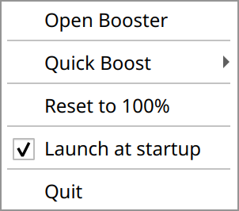

# Volume Booster

A tiny system-tray app that pushes your Linux audio **above 100%** — for YouTube
videos and other sources that are so quiet you can hardly hear them even with the
player and desktop volume maxed out.

It works by asking PipeWire/PulseAudio to apply digital gain on your default
sink. No audio is re-routed or re-encoded; it simply raises the output level.


## Screenshots

The slider window (left) and the tray context menu (right):

<p align="center">
  
  
</p>

## Why? Can't I just turn everything up?

YouTube's own volume slider and your desktop volume both top out at 100%. When a
recording itself is mastered very quietly, "100%" everywhere still leaves you at
a whisper. Volume Booster adds headroom **above** that ceiling.

## Features

- **Left-click** the tray icon → a floating **0–200% slider** with − / + fine
  buttons and a "Reset to 100%" button.
- **Right-click** → quick presets **100 / 125 / 150 / 175 / 200%**, Reset, Quit.
- The icon turns **orange with a live % badge** whenever you're boosted
  (white at normal level, gray when muted).
- Live-syncs with media keys and your desktop's volume widget, so it never fights
  them.

## How much can it boost? (practical limits)

There is **no meaningful software ceiling** — PipeWire stores volume as a 32-bit
value whose maximum is roughly **6.5 million percent** (~96 dB of gain). That is
not a recommendation. The *useful* limit is set by **digital clipping**, because
at 100% the DAC is already outputting full scale (0 dBFS); anything above 100% is
pure software gain.

| Boost | Gain    | When it's useful                            |
| ----- | ------- | ------------------------------------------- |
| 100%  | 0 dB    | normal listening                            |
| 125%  | +1.9 dB | gentle lift                                 |
| 150%  | +3.5 dB | quiet videos — comfortable sweet spot       |
| 200%  | +6.0 dB | very quiet dialogue/podcasts (default cap)  |
| 300%  | +9.5 dB | extremely quiet sources, mild clipping      |
| 400%+ | +12 dB+ | mostly clipping; risky for your ears/speakers |

> **Practical answer:** for most "can barely hear it" content, **150–200%** is the
> sweet spot. The default ceiling is **200%** (raise it by editing `MAX_PCT` in
> `volume_booster.py`). Be careful above ~300% — a sudden loud transient at high
> boost can distort or hurt your hearing.

## Requirements

- Linux with **PipeWire** or **PulseAudio**, **Python 3**, **PyQt6**, and `pactl`.

## Install

Every major distro family is covered:

| Distro family                     | Package                                                      |
| --------------------------------- | ------------------------------------------------------------ |
| Debian / Ubuntu                   | `.deb`                                                       |
| Fedora                            | `.rpm`                                                       |
| RHEL / Rocky / Alma               | `.rpm`                                                       |
| openSUSE Leap / Tumbleweed        | `.rpm`                                                       |
| Arch / Manjaro                    | `PKGBUILD` (and AUR)                                         |
| NixOS                             | `flake.nix`                                                  |
| Universal (any distro)            | `Flatpak` or `AppImage`                                      |
| Any Linux (no root)               | `install.sh` portable installer                              |

Prebuilt artifacts are on the
[releases](https://github.com/VanguardArts/volume-booster/releases) page.

### Debian / Ubuntu

```bash
sudo apt install ./volume-booster_1.1.1_all.deb
```

### Fedora / RHEL / Rocky / Alma

```bash
sudo dnf install ./volume-booster-1.1.1-1.noarch.rpm
```

### openSUSE

```bash
sudo zypper install ./volume-booster-1.1.1-1.noarch.rpm
```

### Arch Linux

```bash
# from the repo
cd arch && makepkg -si
```

### NixOS / Nix

```bash
nix run github:VanguardArts/volume-booster
# or, in a flake-enabled system:
nix profile install github:VanguardArts/volume-booster
```

### Flatpak (universal)

```bash
flatpak install ./volume-booster.flatpak
```

### AppImage (universal)

```bash
chmod +x ./volume-booster-x86_64.AppImage
./volume-booster-x86_64.AppImage
```

### Portable installer (any distro, no root)

```bash
./install.sh            # installs to ~/.local
```
Override with `PREFIX=/usr/local ./install.sh` (use `sudo`).

### From source

```bash
python3 volume_booster.py
```

## Usage

**First launch** — after installing, either:

```bash
volume-booster          # from a terminal
```
…or search for **"Volume Booster"** in your application launcher (app menu) and
click it.

**Start at login (autostart):**

```bash
./install.sh --autostart        # install AND enable autostart
# or, if already installed:
scripts/enable-autostart.sh     # enable autostart
scripts/disable-autostart.sh    # disable autostart
```

This drops a launcher into `~/.config/autostart/` so the app starts when you
sign in.

## Uninstall

```bash
./uninstall.sh                      # portable install
sudo apt remove volume-booster      # .deb
sudo dnf remove volume-booster      # .rpm (Fedora/RHEL)
sudo zypper remove volume-booster   # .rpm (openSUSE)
flatpak uninstall com.vanguardarts.VolumeBooster
```

## Building the installers

```bash
make icons     # regenerate PNG icon set (requires cairosvg)
make screenshots
make deb       # -> build/deb/*.deb
make rpm       # -> build/rpm/RPMS/noarch/*.rpm
make flatpak   # -> build/flatpak/volume-booster.flatpak  (needs flatpak-builder)
make appimage  # -> build/appimage/*.AppImage            (best run in CI)
```
See `scripts/` for the individual build scripts and `.github/workflows/release.yml`
for the CI-driven release pipeline (builds `.deb` and `.rpm` on every `v*` tag).

## License

MIT — see [LICENSE](LICENSE).
